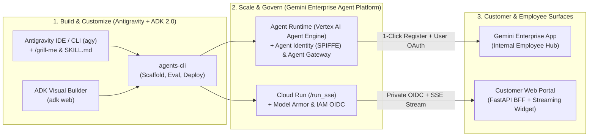

# Google Cloud SMB Agent Launchpad (`adk-antigravity-smb-starter-kit`)

> **Zero to Production Agent in 30 Minutes** — Reference Architecture, Working Templates, and Deployment Kit for SMB Customers on the **Gemini Enterprise Agent Platform** using **ADK 2.0**, **Google Antigravity (`agy`)**, and **`agents-cli`**.

[](https://google.github.io/adk-docs/)
[](https://docs.cloud.google.com/gemini-enterprise-agent-platform/models/google-models)
[](https://cloud.google.com/architecture/framework)

---

## 1. Overview & Campaign Value Proposition

Small and Medium Businesses (SMBs) need AI agents that directly drive **customer acquisition, front-office conversion, and customer retention**—without requiring months of custom R&D or a dedicated DevOps team.

This starter kit combines three core innovations from Google Cloud:
1. **Gemini Enterprise** as the unified employee front-door (enterprise search, Google Workspace grounding, OAuth identity, and zero-code UI).
2. **ADK 2.0 + `agents-cli` Templates** providing production-ready, industry-agnostic agent architectures with built-in evaluation datasets, deterministic guardrails, and Terraform IaC.
3. **Google Antigravity (`agy`) + ADK Visual Builder (`adk web`)** enabling **Agent-to-Agent Engineering**: developers use `/grill-me` and pre-loaded `SKILL.md` contracts ([`.gemini/skills/smb-agent-scaffolder/SKILL.md`](.gemini/skills/smb-agent-scaffolder/SKILL.md)) so Antigravity customizes, tests, evaluates, and deploys the agents automatically.



---

## 2. The 3 Industry-Agnostic SMB Agent Templates (`Acquire -> Serve -> Retain`)

Every template ships with **Dual-Mode Data Support**:
- **`DATA_BACKEND="mock"` (Default):** Runs 100% out-of-the-box in seconds using realistic pre-seeded data for *Aura & Co. Botanical Wellness*—ideal for live workshops, demos, and local CI testing.
- **`DATA_BACKEND="gcp"`:** Switches seamlessly to live **Vertex AI Search (RAG Engine)**, **Cloud Firestore**, and **BigQuery**.

| # | Agent Template | Business Goal | ADK 2.0 Architecture & Google Models | Primary Surface & Runtime |
| :- | :--- | :--- | :--- | :--- |
| **1** | **[`agents/marketing_copilot`](agents/marketing_copilot/)**<br>*"Growth Engine" Marketing & Campaign Copilot* | **Acquire Customers:** Ground in brand kits & product margins in Drive, research competitor trends, generate visual briefs, and launch multi-channel campaigns. | **Agentic RAG + Multimodal Briefs**<br>• Reasoning: `gemini-3.1-pro-preview`<br>• Visuals: `gemini-3.1-flash-image` (Nano Banana 2.1) | **Agent Runtime** (Vertex AI Agent Engine) registered in **Gemini Enterprise** |
| **2** | **[`agents/frontdesk_triage`](agents/frontdesk_triage/)**<br>*"24/7 Front-Desk" Triage & Booking Agent* | **Serve & Convert:** Answer real-time inventory questions, check specialist availability, sanitize PII, and book appointments 24/7. | **Low-Latency ReAct + Firestore Tools**<br>• Model: `gemini-3-flash-preview`<br>• Streaming: `/run_sse` ([Codelab 1](https://codelabs.developers.google.com/build-deploy-embed-agy-agents-cli#0)) | **Cloud Run** embedded in Customer Portal via [`web_embed_demo/app.py`](web_embed_demo/app.py) |
| **3** | **[`agents/churn_retention_radar`](agents/churn_retention_radar/)**<br>*"Retention Radar" Churn & Win-Back Agent* | **Retain & Expand:** Detect at-risk accounts from order/usage drops, diagnose root causes from tickets, and dispatch policy-guarded win-back offers. | **ADK 2.0 `SequentialAgent` Workflow**<br>1. `ChurnRiskDetector` (`gemini-3-flash-preview`)<br>2. `RootCauseDiagnosisAgent` (`gemini-3.1-pro-preview`)<br>3. `WinBackActionAgent` + HITL Guardrail ([Codelab 2](https://codelabs.developers.google.com/codelabs/create-low-code-agent-with-ADK-visual-builder#9)) | **ADK Visual Builder (`adk web`)** -> **Agent Runtime** or **Cloud Run** |

---

## 3. Quickstart: Run & Test Locally in 2 Minutes

### Step 1: Clone & Configure Environment
```bash
git clone https://github.com/gabbarbosateixeira/adk-antigravity-smb-starter-kit.git
cd adk-antigravity-smb-starter-kit
cp .env.example .env
```

### Step 2: Install Dependencies & Run the Verification Suite
```bash
# Create virtual environment and install dependencies
python3 -m venv .venv
.venv/bin/pip install -r requirements.txt

# Run the automated end-to-end tool & guardrail test suite (works immediately in mock mode!)
.venv/bin/pytest tests/ -v
```

### Step 3: Customize with Antigravity (`agy`) or ADK Visual Builder (`adk web`)

#### Option A: Agent-to-Agent Engineering with Antigravity (`agy`)
Open this repository in **Antigravity IDE** or launch the **Antigravity CLI (`agy`)**. Antigravity automatically loads [`GEMINI.md`](GEMINI.md) and [`.gemini/skills/smb-agent-scaffolder/SKILL.md`](.gemini/skills/smb-agent-scaffolder/SKILL.md):
```text
$ agy
> /grill-me Adapt the 24/7 Front-Desk Triage agent and Churn Retention Radar for a multi-location Dental Clinic.
```

#### Option B: Low-Code Canvas with ADK Visual Builder (`adk web`)
Following [Codelab 2 (Create Low-Code Agents with ADK Visual Builder)](https://codelabs.developers.google.com/codelabs/create-low-code-agent-with-ADK-visual-builder#9):
```bash
.venv/bin/adk web agents/ --port 8080
```
Open `http://localhost:8080` to inspect the 3 agents visually, modify the `SequentialAgent` nodes in [`agents/churn_retention_radar/visual_builder_workflow.yaml`](agents/churn_retention_radar/visual_builder_workflow.yaml), and test live tool trajectories.

---

## 4. Governance, Security & Guardrails (The 4 Pillars)

This repository implements the **Gemini Enterprise Agent Platform** security and governance model:

1. **Inbound Access Control (Who Can Call the Agent?):**
   - **Internal Employees (Gemini Enterprise):** Governed by Google Workspace / Cloud Identity IAM and Google Groups.
   - **External Customer Portals (Cloud Run `/run_sse`):** Deployed with `--no-allow-unauthenticated` and `INGRESS_TRAFFIC_INTERNAL_LOAD_BALANCER`. External web apps call the agent through the Backend-for-Frontend ([`web_embed_demo/app.py`](web_embed_demo/app.py)) using **Cloud IAM OIDC Service Account tokens**.
2. **Outbound Access Control (What Can the Agent Access?):**
   - **Agent Identity (SPIFFE):** Cryptographic agent identity using mTLS/DPoP and on-behalf-of end-user OAuth token pass-through so RAG queries strictly respect Google Drive / BigQuery ACLs.
   - **Agent Gateway & Model Armor:** Centralized ingress/egress inspection for MCP and tool calls, combined with [`shared/guardrails.py`](shared/guardrails.py) for prompt-injection blocking and automatic SSN/Credit Card PII redaction.
3. **Deterministic Policy & Human-in-the-Loop (HITL) Guardrails:**
   - Both the **Marketing Copilot** and **Retention Radar** agents enforce [`enforce_discount_guardrail`](shared/guardrails.py) before executing promotional or win-back tools: any autonomous discount above `MAX_AUTONOMOUS_DISCOUNT_PCT` (`20%`) is deterministically blocked with `HITL_APPROVAL_REQUIRED` until a human manager approves (`manager_approved=True`).

---

## 5. Evaluation & Testing (`agents-cli eval run`)

Each agent includes a ready-to-run `eval/` directory containing an `eval_config.yaml` and a `golden_dataset.json` covering both happy-path trajectories and adversarial policy/guardrail tests:
- [`agents/marketing_copilot/eval/golden_dataset.json`](agents/marketing_copilot/eval/golden_dataset.json)
- [`agents/frontdesk_triage/eval/golden_dataset.json`](agents/frontdesk_triage/eval/golden_dataset.json)
- [`agents/churn_retention_radar/eval/golden_dataset.json`](agents/churn_retention_radar/eval/golden_dataset.json)

```bash
# Run LLM-as-a-Judge trajectory and groundedness evaluations via agents-cli
agents-cli eval run \
  --config agents/churn_retention_radar/eval/eval_config.yaml \
  --dataset agents/churn_retention_radar/eval/golden_dataset.json
```

---

## 6. Deployment Guide: 1-Command Script vs. Terraform

We recommend a **Two-Stage Maturity Model** for SMB customers:

### Stage 1: Day-1 Fast PoC (`deployment/scripts/`)
Get a live endpoint in under 5 minutes without managing Terraform state:
```bash
# Deploy Front-Desk Triage Agent to private Cloud Run (/run_sse)
chmod +x deployment/scripts/*.sh
./deployment/scripts/deploy_cloud_run.sh agents/frontdesk_triage

# Deploy Marketing Copilot or Churn Retention Radar to Vertex AI Agent Engine & Gemini Enterprise
./deployment/scripts/deploy_agent_engine.sh agents/marketing_copilot
./deployment/scripts/deploy_agent_engine.sh agents/churn_retention_radar
```

### Stage 2: Day-2 Production Infrastructure-as-Code (`deployment/terraform/`)
When moving to production with customer data, provision least-privilege IAM Service Accounts, APIs, Cloud Trace telemetry, and locked-down Cloud Run services via Terraform:
```bash
cd deployment/terraform
terraform init
terraform plan -var="project_id=${GOOGLE_CLOUD_PROJECT}"
terraform apply -var="project_id=${GOOGLE_CLOUD_PROJECT}"
```

---

## 7. Repository Structure

```text
adk-antigravity-smb-starter-kit/
├── GEMINI.md                                    # Antigravity & Gemini CLI system instructions
├── .gemini/skills/smb-agent-scaffolder/SKILL.md # Antigravity skill for /grill-me customization
├── shared/
│   ├── config.py                                # Gemini 3.1 Pro / 3 Flash / 3.1 Flash Image config
│   ├── guardrails.py                            # Deterministic 20% discount cap, PII & injection filter
│   └── telemetry.py                             # OpenTelemetry & Google Cloud Trace exporter
├── agents/
│   ├── marketing_copilot/                       # Agent 1: Acquire (RAG + Trends + Visual Briefs)
│   ├── frontdesk_triage/                        # Agent 2: Serve (Firestore + /run_sse Booking)
│   └── churn_retention_radar/                   # Agent 3: Retain (Sequential Workflow + Visual Builder YAML)
├── web_embed_demo/
│   └── app.py                                   # FastAPI BFF for embedding /run_sse in customer portals
├── deployment/
│   ├── scripts/                                 # Stage 1: 1-command Cloud Run & Agent Engine scripts
│   └── terraform/                               # Stage 2: Production Well-Architected Terraform IaC
└── tests/
    └── test_all_agents.py                       # Automated verification of all 3 agents & guardrails
```
